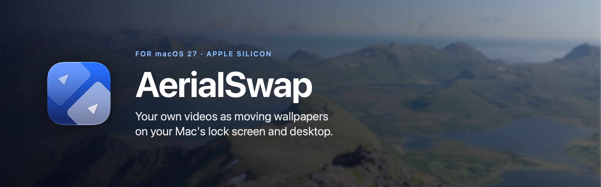
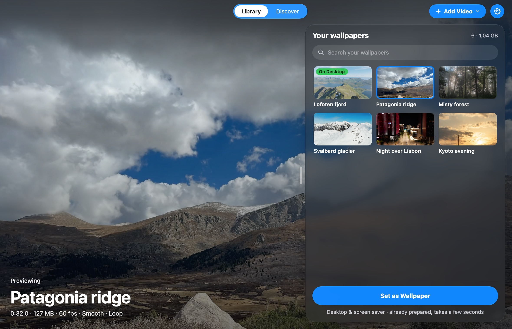
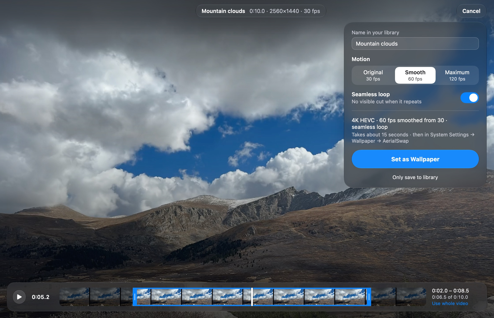
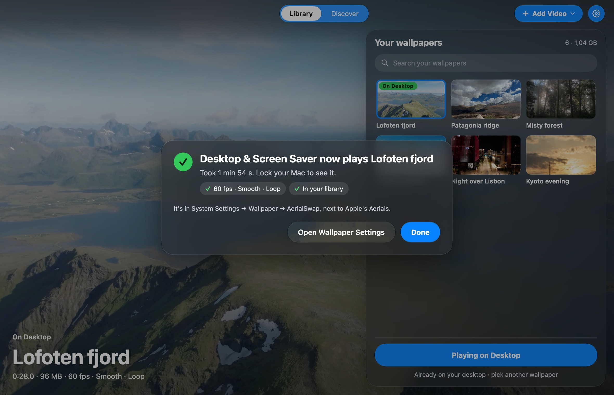
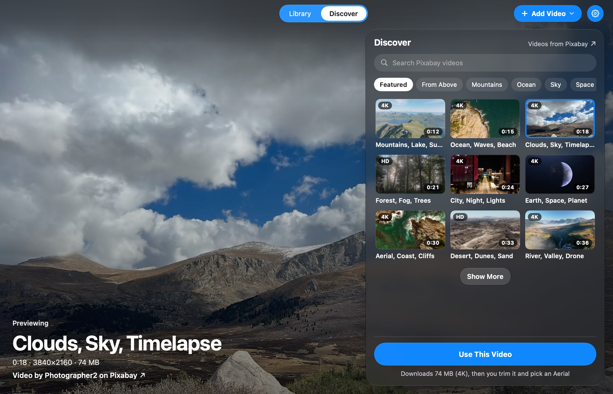

<p align="center">
  
</p>

<p align="center">
  <a href="https://github.com/mxpalm/AerialSwap/releases/latest"></a>
  
  
  
</p>

Your Mac's lock screen can show beautiful slow-motion Aerial videos of landscapes and cities. **AerialSwap lets you
put your own videos there**: a holiday clip, a drone flight, or one of thousands of free videos it finds for you.
They play exactly like Apple's Aerials, on the lock screen and the desktop, and gently slow down when you unlock.

Your videos get their own **AerialSwap** group in System Settings → Wallpaper, right next to Apple's. Apple's own
Aerials stay untouched.

<p align="center">
  
</p>

## What you can do

- **Use any video.** Drag a video onto the window, paste a link, or pick a free video inside the app.
- **Pick the best part.** Trim the video to the few seconds you like.
- **No jump when it repeats.** AerialSwap blends the end into the beginning, so the loop looks seamless.
- **Smooth slow-down.** It adds in-between frames, so the video glides to a stop when you unlock, like Apple's.
- **Switch in seconds.** Every wallpaper you make is kept in your library, ready to use again.
- **Nothing running in the background.** macOS plays the videos itself, just like its own Aerials.

## Download and install

You need a Mac with Apple Silicon (M1 or later) and macOS 27.

1. **Download** `AerialSwap-1.0.zip` from the [latest release](https://github.com/mxpalm/AerialSwap/releases/latest)
   and double-click it to unzip.
2. **Move** `AerialSwap` into your **Applications** folder.
3. **Open it.** The first time, macOS shows a warning, because AerialSwap is a free app from an independent
   developer and isn't registered with Apple. To open it anyway:
   1. Click **Done** in the warning.
   2. Open **System Settings → Privacy & Security** and scroll down.
   3. Next to "AerialSwap was blocked", click **Open Anyway**, then confirm with your password.

   You only need to do this once.
4. **Haven't used an Aerial yet?** Open System Settings → Wallpaper, pick any of Apple's Aerials once, then come
   back to AerialSwap. That way macOS sets up what AerialSwap needs.

## How to use it

### 1. Add a video

Drag a video file anywhere onto the AerialSwap window, or click **Add Video**. You can also add a video from a
link (**Add Video → From URL…**), or find a free one under **Discover** (see below).

Any length works. Videos in 4K, filmed in landscape (wider than tall) with slow camera movement, look best.

### 2. Choose the part you like

<p align="center">
  
</p>

- **Trim:** drag the blue handles on the bar at the bottom. The preview plays only the part you picked.
- **Name:** this is what the wallpaper is called in your library and in System Settings.
- **Motion:** *Smooth* (recommended) adds in-between frames for a fluid slow-down when you unlock.
- **Seamless loop:** blends the end into the start, so you never see a cut.
- **Enhance detail** (for smaller videos): uses your Mac's built-in AI upscaling to make them sharper. It takes
  much longer, and the result varies from video to video.

### 3. Set it as your wallpaper

Click **Set as Wallpaper**. AerialSwap prepares the video in 4K. A short clip usually takes a minute or two, and
you'll see the progress. Then it switches your desktop and screen saver to the new video.

<p align="center">
  
</p>

**Lock your Mac to see it.** You'll also find it in System Settings → Wallpaper → AerialSwap.

### Switch between your wallpapers

Everything you've made stays in **Your wallpapers** on the right. Click one to preview it, then click
**Set as Wallpaper**: switching takes only a few seconds. Right-click a wallpaper to use it only for the desktop or
only for the screen saver, or to delete it.

Click on the video itself to hide the library and see the wallpaper the way your lock screen will show it.

### Find free videos (Discover)

<p align="center">
  
</p>

Click **Discover** at the top to browse thousands of free, high-quality videos from [Pixabay](https://pixabay.com).
Pick a topic or search for anything, click a video to preview it, then **Use This Video**. AerialSwap downloads it
in 4K and takes you to step 2.

## Questions

**Is it safe?**
AerialSwap only adds its own videos to the list of Aerials. It never changes or deletes Apple's videos and never
asks for your password. It's free and open source, so anyone can check the code.

**Does it slow down my Mac or drain the battery?**
No. Once a wallpaper is set, AerialSwap doesn't need to run. macOS plays the video exactly like its own Aerials.
Preparing a new video takes some computing power for a minute or two.

**My AerialSwap wallpapers disappeared from System Settings.**
macOS sometimes downloads a new list of Aerials and removes the group. AerialSwap adds it back automatically within
seconds. If it doesn't, just open AerialSwap once.

**Will it keep working after macOS updates?**
Usually yes, but AerialSwap uses parts of macOS that Apple doesn't officially offer to other apps, so a big update
can break it until a new version comes out. Your library always keeps your videos.

**How do I get updates?**
AerialSwap checks once a day and tells you when a new version is out. Click the ⚙ button in the top right, then
**Update to AerialSwap …**: it downloads the update, checks that it really comes from AerialSwap, installs it and
restarts. (Coming from version 1.0? Download 1.1 once by hand, the same way as the first time. After that, updates
work from inside the app.)

**Does it play sound?**
No. Wallpapers are silent, just like Apple's Aerials.

**Can I use any video I find online?**
Only use videos you're allowed to use: your own, or free ones like those in Discover.

**Something went wrong.**
Click the ⚙ button in the top right, then **Open Log**, and attach the log when you
[report the problem](https://github.com/mxpalm/AerialSwap/issues).

## Uninstall

1. Quit AerialSwap.
2. Open the **Terminal** app, paste this line and press Return. It removes the AerialSwap group from System
   Settings and puts Apple's list back the way it was:

   ```sh
   /Applications/AerialSwap.app/Contents/MacOS/AerialSwap --remove-group
   ```

3. Move AerialSwap from your Applications folder to the Trash.

Your wallpapers stay in `~/Library/Application Support/AerialSwap/` in case you come back. To remove everything,
delete that folder too, plus `~/Library/Caches/AerialSwap` and `~/Library/Logs/AerialSwap.log`. Deleted the app
first? See [Removing the group without the app](docs/TECHNICAL.md#removing-the-group-without-the-app).

## For developers

Building from source, every option in detail, how AerialSwap works inside macOS, tests and releases:
see [docs/TECHNICAL.md](docs/TECHNICAL.md).

## License and credits

AerialSwap is free and open source under the MIT license, see [`LICENSE`](LICENSE). Tools and services it can use
keep their own licenses and terms, see [`THIRD_PARTY_NOTICES.md`](THIRD_PARTY_NOTICES.md).

AerialSwap is an independent app and isn't made by or affiliated with Apple. The videos in the screenshots are free
videos from [Pixabay](https://pixabay.com) by u_flivu11rsh, JoshuaWoroniecki, adege, mariancroitoru, D-GM,
Kanenori, bellergy, vkhima, antonlukin and videohive. The names and details shown in the screenshots are examples.
